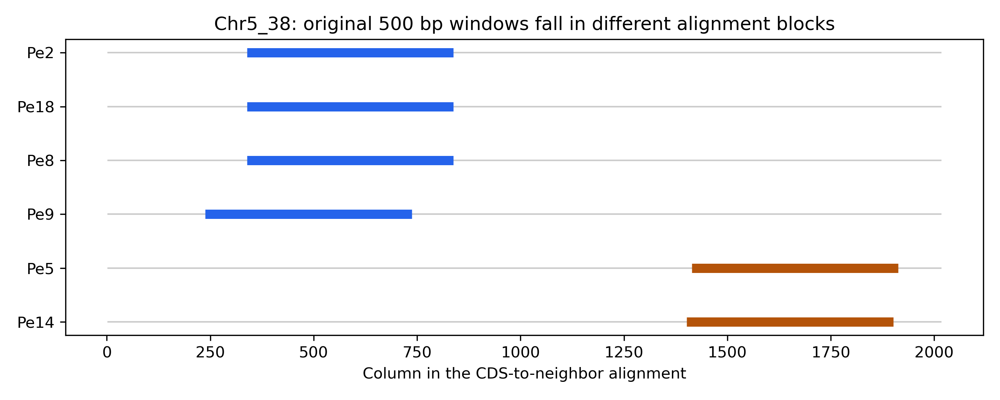

# Conserved genes, variable neighborhoods?

**Week 12 data re-use project · *Peronospora effusa* pangenome**

[Open the standalone HTML report](index.html) · [Reproduce the pilot](docs/reproduce_pilot.md) · [Read the candidate validation](reports/pilot/Chr5_38_validation.md)

## What the pilot found

We reused the published *P. effusa* pangenome to ask whether conservation of a single-copy core gene extends into its upstream neighborhood. All 19 assemblies defined the core set; the sequence pilot used six isolates and 100 randomly sampled loci.

At 500 bp, the screen flagged one of 32 resolved, coding-conserved loci. The hit, **`Chr5_38`**, had 0.37% CDS divergence and 42.35% apparent upstream divergence. A larger alignment showed that the original windows shared **zero alignment columns** across the two isolate groups, despite 99.60–99.90% callable identity in the larger interval. The hit did not validate as a comparison of equivalent upstream sequence.



| Pilot outcome | 500 bp | 1,000 bp |
|---|---:|---:|
| Sampled loci | 100 | 100 |
| Loci with extractable windows in all six isolates | 47 | 30 |
| Unresolved or intermediate (class E) | 65 | 81 |
| Screen hits / resolved coding-conserved loci | 1 / 32 | 0 / 16 |
| Screen hits supported by follow-up | 0 | No hit to review |

No full 19-isolate sequence comparison was run. The unresolved counts exceeded the full-run gate at both window sizes. The results demonstrate a fixed-window failure mode; they do not establish that upstream variation is rare, predict expression, or identify a TE insertion.

## What is here

- [Research report](index.html): methods, QC, results, figures, and interpretation. Save and open the HTML in a browser if your GitHub view shows source.
- [Pilot tables](results/pilot/): published summaries, the locus-level screen, pairwise comparisons and validation tables.
- [Original figures](figures/pilot/): PNG and PDF plots from the HPC pilot. The fixed-window candidate figure shows the original screen; use the anchored figure above for the validated interpretation.
- [Publication records](publication/): verified source file hashes, assembly/annotation hashes, software versions and the pilot gate outcome.
- [Code](src/pe_upstream/), [configurations](config/), [workflow](Snakefile), [environments](envs/) and [tests](tests/): analysis and replay instructions.

The copy in `Week_12` retains local HPC outputs. Git excludes downloaded and extracted inputs, large intermediates, environments, original machine-specific receipts and logs. No source assembly FASTA, archive, or annotation file is shipped in the Git snapshot.

## Start here

To read results, no installation is required. To exercise the code offline:

```bash
python3 -m unittest discover -s tests -v
```

To reproduce the biological pilot, follow [the replay guide](docs/reproduce_pilot.md). It describes bootstrapping, source retrieval, orthogroup conversion, compute-node execution and candidate validation. It keeps replay outputs separate from the published evidence.

## Sources and attribution

Skiadas et al. (2026), [Pangenome graph analysis reveals evolution of resistance breaking in spinach downy mildew](https://doi.org/10.1371/journal.pbio.3003596), *PLOS Biology* 24(1): e3003596. Data: [Zenodo 17977529](https://doi.org/10.5281/zenodo.17977529), [PRJNA772192](https://www.ncbi.nlm.nih.gov/bioproject/PRJNA772192). The [MIT license](LICENSE) applies to this repository’s code, not the external data.
